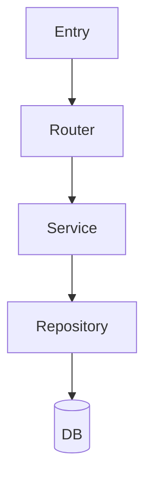

# Codebase Memory Skill

Generates a **layered memory directory** (`memory/`) by deeply analysing a codebase.
Every new agent loads only the layer it needs — no more reading thousands of lines of source.

---

## Memory Directory Layout

```
memory/
├── codebase.md              ← ALWAYS LOADED — master index + architecture (<4 000 tokens)
├── modules/
│   ├── <module-name>.md     ← Load on demand — one file per top-level module/package
│   └── ...
└── maps/
    ├── file_index.json      ← Machine-readable: file path → role, classes, functions
    └── call_graph.json      ← Machine-readable: import/dependency edges between files
```

**Loading strategy for agents:**
- Every agent loads `memory/codebase.md` as a system-prompt prefix (always)
- Agent loads `memory/modules/<n>.md` only when its task touches that module
- Agent queries `memory/maps/file_index.json` to find the exact file for a class/function
- Agent queries `memory/maps/call_graph.json` to understand ripple effects of a change

---

## When You Are Invoked

1. Confirm the **target directory** with the user (default: current working directory)
2. Check if `memory/codebase.md` already exists → ask whether to **regenerate** or **update**
3. Run the analysis script to collect raw facts:
   ```bash
   python3 .claude/skills/codebase-memory/scripts/analyze_codebase.py <target_dir> \
       --output-dir memory/
   ```
   This writes `memory/maps/file_index.json` and `memory/maps/call_graph.json`.
4. Synthesise all output layers (see below), writing each file in this order:
   - `memory/maps/file_index.json`  ← from script
   - `memory/maps/call_graph.json`  ← from script
   - `memory/modules/<n>.md`        ← one per module (you write these from raw JSON)
   - `memory/codebase.md`           ← master index (write last, after all modules)

---

## Layer 1 — `memory/codebase.md` (Master Index)

**Token budget: keep under 4 000 tokens.** This file is loaded by every agent on every task.
It must orient the agent without overwhelming it — detailed signatures belong in modules/.

```markdown
# Codebase Memory: <Project Name>
> Generated: <ISO date> | Verified: <ISO date> | Generator: codebase-memory skill v1
> Modules: [auth](modules/auth.md) · [api](modules/api.md) · [payments](modules/payments.md)

## 1. PURPOSE & DOMAIN
<2–3 sentences: what the system does, who uses it, core value proposition>

## 2. HIGH-LEVEL ARCHITECTURE
- **Style**: <Monolith | Microservices | Layered MVC | Event-driven | etc.>
- **Language(s)**: <list>
- **Entry points**: <files>
- **Core data flow**: <e.g. Request → Router → Service → Repository → DB>



## 3. DIRECTORY MAP
src/
  auth/        → JWT + OAuth2 login flows        → see memory/modules/auth.md
  api/         → REST endpoints (v1, v2)          → see memory/modules/api.md
  payments/    → Stripe integration + billing     → see memory/modules/payments.md
  models/      → ORM / data model definitions
  utils/       → Shared helpers (config, logging)

## 4. KEY DESIGN DECISIONS & PATTERNS
- <Pattern>: <one-line explanation of where/why>

## 5. CRITICAL DEPENDENCIES
| Library | Purpose | Key files |
|---------|---------|-----------|
| ...     | ...     | ...       |

## 6. MODULE REGISTRY
| Module   | Path         | Deep-dive                          |
|----------|--------------|------------------------------------|
| auth     | src/auth/    | [modules/auth.md](modules/auth.md) |
| api      | src/api/     | [modules/api.md](modules/api.md)   |
| payments | src/payments/| [modules/payments.md](modules/payments.md) |

## 7. DATA MODELS (summary)
- **User**: id, email, hashed_password, role, created_at
- **Order**: id, user_id (FK→User), status, total, stripe_charge_id

## 8. GOTCHAS & NON-OBVIOUS BEHAVIOUR
- <file/area>: <the surprise — one line>

## 9. AGENT TASK ROUTING HINTS
- "Change login logic"        → src/auth/    + memory/modules/auth.md
- "Add API endpoint"          → src/api/     + memory/modules/api.md
- "Find class X / function Y" → memory/maps/file_index.json
- "Understand ripple effects" → memory/maps/call_graph.json
```

---

## Layer 2 — `memory/modules/<n>.md` (Per-Module Deep Dives)

Write **one file per top-level module/package**. Name the file after the directory:
`src/auth/` → `memory/modules/auth.md`.

```markdown
# Module: <n>
> Path: src/<n>/  |  Part of: [codebase.md](../codebase.md)

## Purpose
<2–3 sentences: what this module owns, what it explicitly does NOT own>

## Files
| File | Role |
|------|------|
| src/<n>/handler.py | HTTP request handlers |
| src/<n>/service.py | Business logic        |

## Classes & Functions
### `src/<n>/service.py`
- **`ServiceClass`** (class): <one-line purpose>
  - `method_name(param: Type) → ReturnType`: <what it does>

### `src/<n>/handler.py`
- `handle_login(req, res)`: Validates credentials, issues JWT, sets cookie

## Internal Data Flow
<ASCII or Mermaid: how data moves through this module>

## Dependencies on Other Modules
- Imports `utils/config` → reads DB_URL and SECRET_KEY
- Calls `models.User`   → for credential lookup

## Consumed By
- `api/router.py` mounts this module's handlers at /auth/*

## Module-Level Gotchas
- <any non-obvious behaviour specific to this module>
```

---

## Layer 3 — `memory/maps/file_index.json`

Written by the analysis script. Schema:

```json
{
  "generated_at": "<ISO datetime>",
  "files": {
    "src/auth/service.py": {
      "language": "Python",
      "role": "Business logic / service layer",
      "module": "auth",
      "classes": ["AuthService"],
      "functions": ["hash_password", "verify_token"],
      "imports": ["models.user", "utils.config"]
    }
  }
}
```

---

## Layer 4 — `memory/maps/call_graph.json`

Written by the analysis script. Schema:

```json
{
  "generated_at": "<ISO datetime>",
  "edges": [
    { "from": "src/api/router.py", "to": "src/auth/service.py", "type": "import" }
  ],
  "adjacency": {
    "src/auth/service.py": {
      "imports":     ["src/models/user.py", "src/utils/config.py"],
      "imported_by": ["src/api/router.py",  "src/auth/handler.py"]
    }
  }
}
```

---

## Manual Analysis Procedure (when the script is unavailable)

### Step 1 — Walk the tree
```bash
find <dir> -type f | grep -Ev "node_modules|\.git|__pycache__|dist|build" | sort
```

### Step 2 — Identify modules
Group top-level directories under `src/` — each becomes one `memory/modules/*.md` file.

### Step 3 — Skim file headers (no full reads yet)
```bash
head -40 <file>   # captures imports, class names, function signatures, docstrings
```

### Step 4 — Deep-read core files
Entry points, shared config, data models, and the 2–3 most central service files.

### Step 5 — Write in order
1. `memory/maps/file_index.json`
2. `memory/maps/call_graph.json`
3. `memory/modules/<n>.md`  (one per module, bottom-up)
4. `memory/codebase.md`     (synthesise from modules — write last)

---

## Hook Function

A **PostToolUse hook** fires after every `Bash` tool call. On the first run in a
project session it checks for `memory/codebase.md`. If missing, it prints a banner
prompt. If the file is >30 days old, it prints a soft staleness warning.

Install:
```bash
bash .claude/skills/codebase-memory/hooks/install_hook.sh
```

Uninstall:
```bash
bash .claude/skills/codebase-memory/hooks/install_hook.sh --uninstall
```

---

## Updating Existing Memory

When the user says "update the memory" or "re-analyse":
1. Read `memory/codebase.md`, note its `Verified` date
2. `git diff --name-only <verified-date>..HEAD` to find changed files
3. Determine which modules those files belong to
4. Regenerate only the affected `memory/modules/*.md` files
5. Re-run the script with `--incremental` to patch `file_index.json` and `call_graph.json`
6. Rebuild `memory/codebase.md` module registry and bump `Verified`

---

## Quality Checklist (self-verify before finishing)

- [ ] `memory/codebase.md` is under 4 000 tokens
- [ ] Every top-level source directory has a corresponding `memory/modules/<n>.md`
- [ ] Every module file lists all public classes and public functions with one-line descriptions
- [ ] `memory/maps/file_index.json` has an entry for every source file
- [ ] `memory/maps/call_graph.json` has edges for all inter-module imports
- [ ] Section 8 (Gotchas) has at least one entry — write "None found" if genuinely none
- [ ] Section 9 (Task Routing) has ≥6 entries including pointers to module files and maps
- [ ] Mermaid diagram in codebase.md compiles (check bracket matching)
