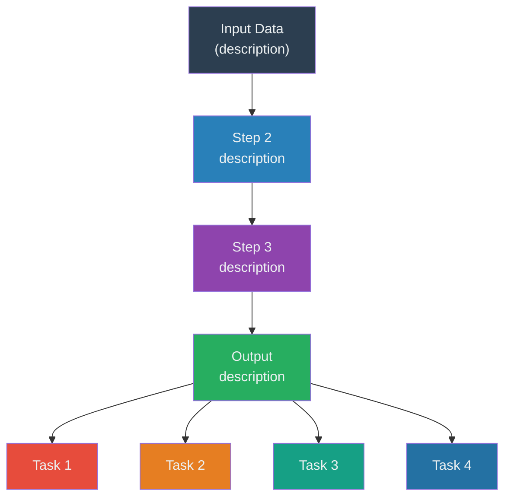

# Paper → Notion Literature Note

Paper URL: $ARGUMENTS

Follow every step below in order. Do not skip steps.

---

## Step 1 — Resolve the paper

Run these two calls in parallel:

1. **WebSearch** `"<title or DOI from URL> full text authors abstract figures"` to confirm the paper title, authors, journal, year, and DOI.
2. **WebSearch** `"site:pmc.ncbi.nlm.nih.gov <title or DOI>"` to find the PubMed Central open-access URL (looks like `https://pmc.ncbi.nlm.nih.gov/articles/PMC<ID>/`). PMC is required for free full text and figure images.

---

## Step 2 — Fetch full article content

Run these calls in parallel using the PMC URL found in Step 1:

**Call A — Introduction + Discussion (verbatim):**
WebFetch on the PMC article URL with prompt:
> "Give me the VERBATIM text of the Introduction section and Discussion section. Do not summarize — copy the exact text. Also list all figure numbers and their complete captions verbatim."

**Call B — Results (summaries):**
WebFetch on the PMC article URL with prompt:
> "List each Results subsection heading and give a 2–3 sentence summary of what was demonstrated. Note which figures correspond to each subsection."

**Call C — Figure image URLs:**
WebFetch on the PMC article URL with prompt:
> "Find and list all figure image URLs in this page. Look for img src attributes pointing to high-resolution figure images on cdn.ncbi.nlm.nih.gov. Return each figure number and its full image URL."

PMC high-res figure URLs follow this pattern:
`https://cdn.ncbi.nlm.nih.gov/pmc/blobs/<hash>/<article_id>/<file_hash>/<filename>.jpg`

**Call D — Methods / mathematical content (for computational papers):**
WebFetch on the PMC article URL with prompt:
> "Find the Methods/Materials and Methods section. Extract ALL mathematical formulas, equations, loss functions, objective functions, and distance metrics verbatim. For each formula, include the surrounding text that explains what the variables mean. Also extract algorithmic steps described mathematically. Include equation numbers if present."

If the paper describes a computational method/tool/algorithm, this call is **required**. If the paper is purely experimental biology with no novel computational methodology, skip this call.

---

## Step 3 — Fetch Notion database schema

Use `mcp__plugin_Notion_notion__notion-fetch` on:
- Database URL: `https://www.notion.so/02bc4f6199d9466faf95e95f97672939`
- Data source ID: `aaf641e3-6f3f-4b21-83d4-74c6d1613794`

Check existing `journal`, `Tags`, and `manner` select options so you use exact option strings when creating the page.

---

## Step 4 — Create the Notion page

Use `mcp__plugin_Notion_notion__notion-create-pages` with:
- `parent.data_source_id`: `aaf641e3-6f3f-4b21-83d4-74c6d1613794`

### 4a — Properties to set

| Property | Value |
|---|---|
| `Name` | Full paper title \| Journal Name |
| `Author` | Comma-separated author list |
| `Published Year` | Year as number |
| `journal` | Match exactly one option from the database schema (e.g. `"Nature method"`) |
| `Tags` | JSON array string using exact option names from schema (e.g. `'["tool","single-cell","GNN🕸"]'`) |
| `Paper Signature` | Short name / acronym of the method/tool |
| `userDefined:URL` | Original paper URL |
| `status` | `"not started"` |

### 4b — Page content structure

Write the `content` field using Notion-flavored Markdown (tabs for indentation, `<details>` for toggles).

#### Section order:
1. TOC toggle
2. Infographic (see Section 5)
3. `---` divider
4. `# **Abstract**` — full abstract verbatim
5. `---` divider
6. `# **Introduction**` — logical flow summary (see format below)
7. `---` divider
8. `# **Results**` — brief summaries + collapsible figures (see format below)
9. `---` divider
10. `# **Key Methods**` — formulas + algorithmic details (see Step 8.5; **computational papers only**)
11. `---` divider
12. `# **Discussion**` — logical flow summary (see format below)

#### TOC toggle (always include at the very top):
```
<details>
<summary><span color="purple">**TOC**</span> 🎨</summary>
	<table_of_contents color="gray"/>
</details>
```

---

## Step 5 — Infographic block (insert between TOC and Abstract)

Place this entire block between the `---` after the TOC toggle and `# **Abstract**`.

### 5a — Hero callout
```
::: callout {icon="🧬" color="blue_bg"}
**<Method Name>** — <Full Title>
<One sentence core concept of the paper>
**<Author1> · <Author2> · ...** | *<Journal>* Vol. <N>, pp. <X–Y> (<Year>) | DOI: <DOI>
:::
```

### 5b — Pipeline Mermaid diagram
Customize the flowchart to reflect the paper's actual workflow. Use `flowchart TB` with colored nodes. Use `<br>` for line breaks inside node labels (NOT `\n`). Enclose node labels in double quotes when they contain parentheses or special characters. Example structure:

```

```

### 5c — Task/contribution columns (2 columns, stacked)

Use **2 columns** with 2 callouts stacked in each column. Do NOT use 4 columns — they render too tight visually.

```
<columns>
	<column>
	::: callout {icon="<emoji>" color="purple_bg"}
	**① <Task 1 Name>**
	<2-sentence description>
	:::
	::: callout {icon="<emoji>" color="green_bg"}
	**② <Task 2 Name>**
	<2-sentence description>
	:::
	</column>
	<column>
	::: callout {icon="<emoji>" color="orange_bg"}
	**③ <Task 3 Name>**
	<2-sentence description>
	:::
	::: callout {icon="<emoji>" color="pink_bg"}
	**④ <Task 4 Name>**
	<2-sentence description>
	:::
	</column>
</columns>
```

### 5d — Applications / experiments table
```
<table header-row="true" fit-page-width="true">
	<tr>
		<td>**Application**</td>
		<td>**Key Components**</td>
		<td>**Dataset**</td>
		<td>**Key Contribution**</td>
	</tr>
	<tr>
		<td>...</td>
		<td>...</td>
		<td>...</td>
		<td>...</td>
	</tr>
</table>
```

### 5e — Stats row (2 columns, stacked)

Same 2-column layout as 5c. Stack 2 stat callouts per column.

```
<columns>
	<column>
	::: callout {icon="⚡" color="yellow_bg"}
	**<Stat label>**
	<stat value>
	:::
	::: callout {icon="🔌" color="gray_bg"}
	**<Stat label>**
	<stat value>
	:::
	</column>
	<column>
	::: callout {icon="📦" color="brown_bg"}
	**<Stat label>**
	<stat value>
	:::
	::: callout {icon="📖" color="blue_bg"}
	**<Stat label>**
	[<link text>](<url>)
	:::
	</column>
</columns>
```

---

## Step 6 — Introduction section format

Write as **bold-lead paragraphs** summarizing the logical progression of the argument. Do NOT write one long block of text. Each paragraph should start with a bold label:

```
**<Logical step label>.** <2–4 sentence summary of what this part of the intro argues or establishes.>

**<Next step label>.** <Summary>

...
```

Typical logical structure:
1. **Context / motivation** — what the field can do and why it matters
2. **Gap or limitation 1** — what current methods cannot do
3. **Gap or limitation 2** — another class of limitations
4. **The proposed solution** — what the paper does and how it works
5. **Scope / capabilities** — list of tasks/applications
6. **Implementation** — software, compatibility, availability

---

## Step 7 — Results section format

For each subsection:

```
### <Subsection heading>

<2–3 sentence brief summary: what dataset, what was done, what was shown.>

<details>
<summary>**Fig. X | <Figure title>.**</summary>
	
	**a**, <full caption panel a text>. **b**, <full caption panel b text>. ... (full verbatim caption)
</details>
```

Important:
- Use the PMC image URLs from Step 2, Call C
- Include the **full verbatim figure caption** inside the toggle (all panels a, b, c, etc.)
- Make EVERY figure a `<details>` collapsible block
- The image tag and caption text must be indented with a tab inside `<details>`

---

## Step 8 — Discussion section format

Same bold-lead paragraph format as Introduction (Step 6):

```
**<Logical step label>.** <Summary>

**<Logical step label>.** <Summary>
...
```

Typical Discussion structure:
1. **Main achievement** — what SIMBA/the tool accomplishes overall
2. **Key technical insight** — the core novelty that enables the result
3. **Benchmarking** — how it compares to existing methods
4. **Connections to prior work** — related approaches / intellectual lineage
5. **Current limitations** — honest assessment of what the method cannot yet do
6. **Future outlook** — where the field/tool goes next

---

## Step 8.5 — Key Methods section (computational papers only)

**When to include:** Add this section if the paper proposes a new computational method, algorithm, model architecture, or mathematical framework. Skip if the paper is purely experimental biology.

**Placement:** Between Results and Discussion.

### Format

For each major algorithmic component, write a subsection with:

```
### <Component Name>

**<Bold-lead label>.** <1–2 sentence description of what this step does and why.>

$$
<block equation in LaTeX>
$$

where $variable_1$ is ..., $variable_2$ is ... <define all variables>.
```

### Math formula syntax rules (CRITICAL)

**Block equations** — use `$$` on separate lines:
```
$$
z_i = \frac{x_i - \mu_i}{\sigma_i}
$$
```

**Inline equations** — use `$...$` with mandatory whitespace:
```
where $x_i$ is the frequency and $\mu$ is the mean.
```

**Rules:**
1. Block `$$` delimiters MUST each be on their own line
2. Inline `$` MUST have whitespace before opening `$` and after closing `$`
3. Inline `$` MUST NOT have whitespace right after opening `$` or right before closing `$`
4. Do NOT escape LaTeX characters (`\`, `{`, `}`) inside math blocks — they are LaTeX, not Notion markdown
5. Standard LaTeX/KaTeX commands are supported: `\frac`, `\sum`, `\prod`, `\int`, `\mathbf`, `\mathbb`, `\exp`, `\log`, `\text`, `\top`, `\mid`, `\neq`, `\geq`, `\leq`, `\ldots`, `\in`, `\cap`, `\cup`, `\overline`
6. Use parentheses `()` instead of brackets `[]` inside inline math to avoid conflicts with Notion's link syntax
7. For inline math with special characters, prefer the backtick variant: `` $`\mathbf{1}(\cdot)`$ ``
8. Notion may internally convert `$...$` to `` $`...`$ `` — both render identically

### Typical subsections for ML/computational papers

1. **Input representation / feature engineering** — how raw data is encoded
2. **Model architecture** — core model with loss function / objective
3. **Training procedure** — optimization, regularization, cross-validation
4. **Distance metrics / similarity measures** — if clustering or retrieval is involved
5. **Ensemble / integration** — how sub-models are combined
6. **Evaluation metrics** — AUROC, F1, or custom metrics with formulas

### Example Key Methods block

```
# **Key Methods**

### Feature Normalization

**Z-score standardization.** Raw gene usage counts are log-transformed and standardized:

$$
z_i = \frac{x_i - \mu_i}{\sigma_i}
$$

where $x_i$ is the log-transformed frequency of gene $i$ , $\mu_i$ and $\sigma_i$ are the cross-sample mean and standard deviation.

### Sequence Embedding (ESM-2)

**Mean pooling.** Per-residue hidden states from ESM-2 are averaged:

$$
\mathbf{e} = \frac{1}{L} \sum_{i=1}^{L} \mathbf{h}_i
$$

where $\mathbf{h}_i \in \mathbb{R}^{1280}$ are per-residue representations and $L$ is sequence length.
```

---

## Quality checklist before finishing

- [ ] All figures have collapsible blocks with full captions and working image URLs
- [ ] Introduction is a logical-flow summary (NOT a plain dump of the text)
- [ ] Results are brief (2–3 sentences per subsection, not full text)
- [ ] Discussion is a logical-flow summary
- [ ] Infographic has all 5 components: callout, mermaid, columns, table, stats row
- [ ] Page properties are fully filled (Name, Author, Year, Journal, Tags, Paper Signature, URL)
- [ ] Mermaid diagram uses `<br>` for line breaks (NOT `\n`)
- [ ] All figure children are indented with a tab inside `<details>`
- [ ] **For computational papers:** Key Methods section is present with exact formulas
- [ ] **Math syntax:** Block equations use `$$` on own lines; inline equations have whitespace around `$` delimiters
- [ ] **Tags format:** Multi-select uses JSON array string `["tag1","tag2"]` (NOT comma-separated)
